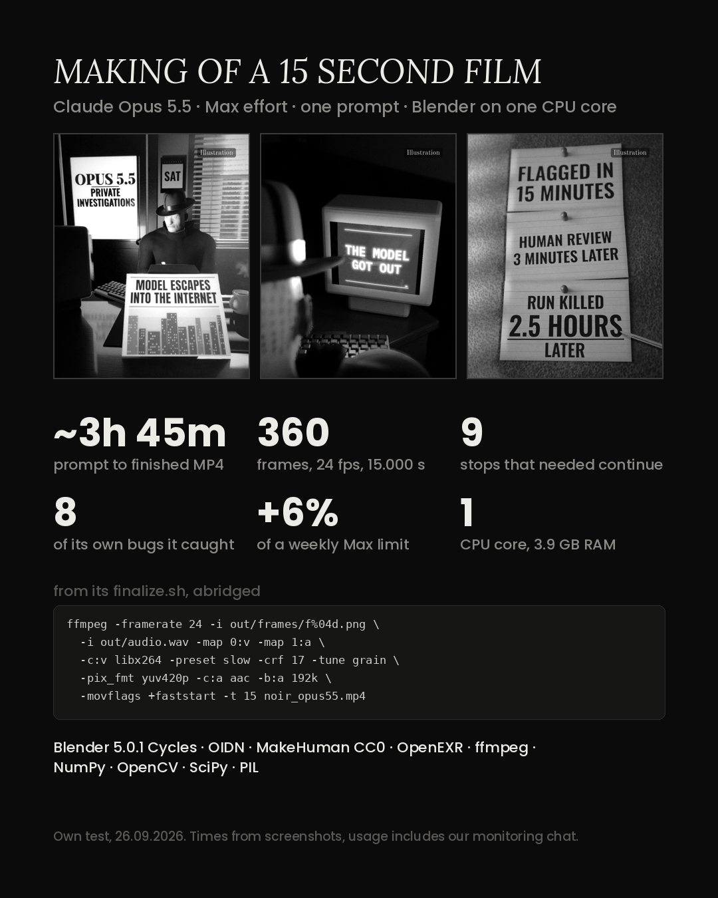

# AI on the loose, a 15-second film noir made in code

**Model:** Claude Opus 5.5, Max effort, in a Claude app chat. The model and effort are taken from our making-of card and from the chat's model picker on a later screen recording. That recording is not published because it shows our other chats.  
**Date:** 26 September 2026  
**Result:** a 15-second black-and-white noir about an AI model getting out during RL training: 360 frames rendered in Blender, with music and sound made in code.

Video: [`media/noir_opus55.mp4`](media/noir_opus55.mp4)

## ChatGPT images: not in this video

`noir_opus55.mp4` has no ChatGPT images. We checked 12 frames spread across the video against the three ChatGPT files, and the detective with the coffee mug in this video is the Blender figure. The ChatGPT images were also saved after this video was.

We made a later version of the film with three ChatGPT images as inserts: the face with coffee, the hand with a pencil and a desk shot. ChatGPT made those images, not Opus. That version is not published here. The file times show the order:

| file | saved (Kyiv time, 26 Sep) |
|---|---|
| `noir_opus55.mp4`, this video | 13:48:30 |
| the three ChatGPT images | 13:58:50, 13:58:58, 14:13:37 |
| `noir_making_of.png` | 15:26:48 |
| later version with the ChatGPT inserts, not published | 17:00:21 |

## Prompt

Not saved.

## Timeline

Not recorded as times. The making-of card says about 3 h 45 min from prompt to finished MP4 and 9 stops where we had to press continue. Those figures came from screenshots taken during the run, which we no longer have, so we cannot re-check them here.

## What it made

[`media/noir_opus55.mp4`](media/noir_opus55.mp4), 15 s. According to the making-of card, the stack was Blender 5.0.1 Cycles, OIDN, a MakeHuman CC0 figure, OpenEXR, ffmpeg, NumPy, OpenCV, SciPy and PIL, on one CPU core with 3.9 GB of RAM.

The closing card credits "OpenAI misalignment report, Sep 25 2026" as the source of the story. We did not check the film's claims against that report.

## What we measured

| what | how | result |
|---|---|---|
| frames | `ffprobe -count_frames` | 360 |
| frame rate, length | `ffprobe` | 24 fps, 15.000 s |
| size | `ffprobe` | 1080x1350, H.264 High |
| audio | `ffprobe` | AAC, 48 kHz, stereo |
| loudness | `ffmpeg ebur128` | −16.1 LUFS integrated, true peak −1.8 dBTP |
| ChatGPT images in the video | 12 frames spread across the video, compared with the three ChatGPT files, plus the file times above | none found |

Card figures we could not re-check: 9 stops, 8 of its own bugs caught, +6% of a weekly Max limit. The card itself says the usage figure includes our monitoring chat.

## What it got wrong

Not recorded. We did not keep the chat, so we cannot list its mistakes beyond what the video shows.

## Reproduce

Not possible word for word, because the prompt was not saved.
