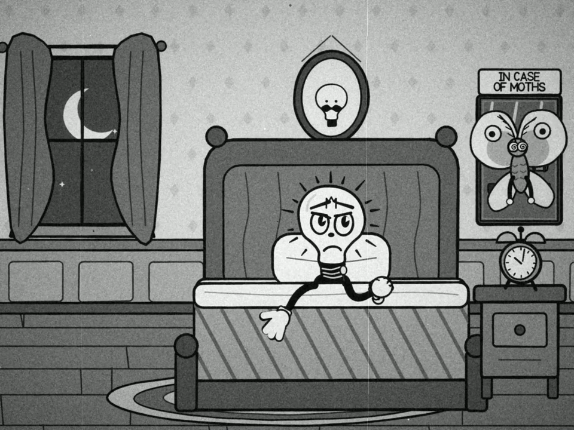

# WATT A NIGHT, a 30-second rubber-hose cartoon drawn in code

**Model:** Claude Sonnet 5.5, Max effort, Claude app  
**Date:** 29 September 2026  
**Result:** 360 drawings and its own jazz score in 53 minutes. It never heard the music.

Video: [`media/WATT_A_NIGHT_web.mp4`](media/WATT_A_NIGHT_web.mp4) (re-encoded to fit GitHub, the original is 1440x1080 at about 15 Mbit/s).

## Prompt

Word for word in [prompt.md](prompt.md). The model had to invent its own character (no mouse, no cat, nothing that looks like an existing studio character), animate on twos, and pick the music itself.

## Timeline

Times are UTC. Start and finish come from the model's own clock, stops from screenshots.

| time | what happened |
|---|---|
| 11:53:35 | model starts its clock after writing the beat sheet |
| 11:58 | stop 1, max message length, right after the beat sheet |
| ~12:38 | stop 2, tool-use limit for the turn, about 37 minutes in |
| 12:46:53 | finished, file checked with ffprobe and ebur128 |

Total by its clock: 53 min 18 s.

## What it made

- Character: Watt, a man with a light bulb for a head. Antagonist: a moth that escapes from a glass case labelled IN CASE OF MOTHS.
- 1440x1080, 24 fps, 720 frames, exactly 30.000 s, AAC 48 kHz, -16.0 LUFS, true peak -7.2 dBFS.
- 360 drawings, each held for two frames, each with its own line boil.
- Music, its choice: original hot jazz in a ragtime feel, 120 BPM, 2/4, F major and D minor. Stride piano, banjo, tuba, clarinet, wah-wah trumpet, xylophone, celesta, drums. It picked 120 BPM because one bar then equals 24 frames, so hits land exactly on actions.

## What it fixed after looking at its own previews

- title letters that ran into each other
- eyelids that read as dark glasses
- the moth covering the mallet
- ghost rectangles on the swing, replaced with a fan smear
- arms stretched so far they looked like threads
- a finale that was too dark, fixed with a patch of moonlight on the floor
- music burying the sound effects, the mix was -11.6 LUFS and it brought it to -16.0

## What it said it would still fix

- It never heard the sound. It checked a spectrogram, loudness and timings only, and warned the synthesised banjo, clarinet and trumpet may sound cheap.
- Glass, floor and wood hits land about 20 ms early.
- On the third swing the arms are stretched about four times and still thin.
- The final scene is small, with a static camera.
- Everything is on twos, including particles and smears, so there is no real motion blur.
- The light flicker runs at about 2 to 2.5 flashes a second. It did not run a formal photosensitivity check.

## What we measured

- File parameters and loudness match its report.
- On a line-based meter (ink masks, grain and gate weave removed), 339 of 359 drawing changes show a clearly new drawing and no change happens inside a pair. It really is on twos.
- For reference, Steamboat Willie (1928, public domain in the US) on the same meter changes the picture about 16 times a second, mixing ones, twos and camera pans.
- We dropped one of our own earlier claims: a blur-based motion meter said the last seconds barely move, but it missed small dark objects. The moth and the Zzz are animated.

## Reproduce

1. New chat, Claude Sonnet 5.5, Max effort.
2. Paste [prompt.md](prompt.md) word for word.
3. Press continue at every stop and log the time.

The model's own source code was not exported from this run. From now on we ask every model to pack its code into a zip when it finishes.
