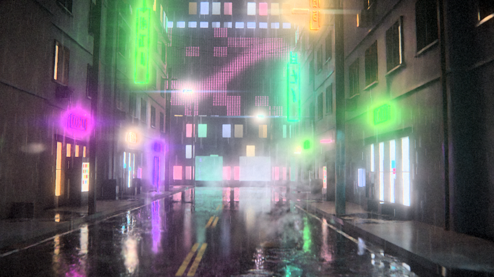

# Cyberpunk ceiling: the most realistic video Sonnet 5.5 could make

**Model:** Claude Sonnet 5.5, Max effort, Claude app (run inside our project chat, so it could see our project files)  
**Date:** 30 September 2026  
**Result:** 360 path-traced frames on one CPU core in about 3 hours of render. 7h 35m on the clock, 3h 09m of it idle.

Video: [`media/neon_rain_city_15s.mp4`](media/neon_rain_city_15s.mp4)

## Prompt

Word for word in [prompt.md](prompt.md). The key lines: "This is a test of your ceiling", no stock footage, textures, models or generators, every frame truly rendered, no time limit, music required.

## Timeline

Times are UTC. Start and finish come from the model's own clock, the rest from screenshots and its status reports.

| time | what happened |
|---|---|
| ~08:47 | prompt sent |
| 08:51:55 | model starts its clock |
| 09:15 | stop 1, max message length, while building the material library |
| ~09:42 | stop 2, it paused itself and asked us to type "continue" |
| 09:42 to 11:21 | idle, nobody pressed continue |
| ~11:21, 11:43, 11:48 | the sandbox VM rebooted and killed the background render each time |
| ~11:51 | stop 3, tool-use limit, 17 of 360 frames done |
| 16:27:41 | finished, MP4 and three stills delivered |

Total by its clock: 7h 35m 46s. About 3h 09m of that the machine sat idle: 1h 38m in the gap above, 1h 09m between its replies, four more stops of 2 to 7 minutes. Working time about 4h 26m. Cycles itself took about 3h 04m for 361 frames (360 plus one re-render).

The render only progressed while the model was mid-turn. It wrote a resumable loop and a watchdog, but after a reboot the watchdog only restarts when the model calls it.

## The machine it found

1 vCPU, 3.9 GB RAM, no GPU. It installed Blender as a Python module (bpy 5.0.1) and rendered with Cycles on the CPU.

## Settings and why

- 1280x720 native, 2 samples per pixel (adaptive) plus OIDN denoising, light bounces 5/2/4/2, indirect clamp 8, about 65 area lights, 16-bit EXR with depth.
- 8 samples per pixel would have cost about 125 s a frame, roughly 12 hours. 960x540 at 4 samples cost the same as 720p at 2 (27.3 s vs 26.1 s), so it kept native resolution for sharper neon text.
- It replaced procedural shaders with baked textures and kept the city static, because animating the world cost an extra 3.4 s a frame. The camera moves about 28 m down the street.
- Render time per frame from its log (357 frames): mean 30.3 s, median 28.2 s. Clean frames 24 to 28.5 s. Frames rendered while post-processing ran in parallel or right after a reboot averaged 39.9 s.

## What is render and what is post

Cycles, real path tracing: geometry, wet PBR materials, neon reflections in puddles and asphalt, shadows, about 65 lights, animated ripples on the puddles, depth for the post pass.

Post-processing in numpy, not traced: depth-based motion blur and depth of field, fog and glow, rain (5,200 drops a frame as 2D streaks), steam as screen-space noise plumes, bloom, halo, lens distortion, chromatic aberration, vignette, tone mapping, grain, sky and the lightning flash.

## Music

Its choice: dark synthwave, 128 BPM, E minor, eight bars that run exactly 15.000 s (one bar is 45 frames). Pads, sidechained bass, drums, arpeggio, FM lead, plus rain, city, distant traffic, a neon hum that follows the real flicker in the picture, and thunder. Hits land on the neon switching on (3.75 s), steam and the focus change (7.5 s), lightning and thunder (11.25 s) and a final bell (13.1 s). It admitted the hit at 9.4 s lands on nothing, the sign it was meant for has already left the frame.

## What it fixed after looking at its own previews

- a road that looked dry, now wetter with more mirror-like puddles
- a far wall that read as a black slab, now with windows, lowered screens and dimmer shop glass
- flat grey fill light, ambient cut from 220 W to 90 W
- soft bokeh, aperture 0.05 to 0.03 with closer focus and sharpening where in focus
- lightning frames 270 to 276 that turned lavender with "snowy" sidewalks, light cut from 2.5e6 W to 1.5e6 W and a milder flash in post
- steam that looked like dark smoke, made brighter, softer and lit by the neon
- bugs: the EXR output format in Blender 5.0 and the VM reboots

## Most and least real frame, its own pick

- Most real: frame 330 (13.75 s), sharp facades, believable reflections. It checked this one at full size.
- Least real: frame 185 (7.7 s), steam as a grey cloud pasted over the scene. It only saw this one in a contact sheet, never at full size, and said so.

## What still gives it away as CG, its own list

1. Rain and steam are drawn in 2D and do not scatter light.
2. Depth of field and motion blur use surface depth, so reflections in puddles blur the wrong way.
3. The geometry is too regular, identical windows, clean walls, flat shop boxes at the end of the street.
4. No people and no cars.
5. 2 samples plus a denoiser give a slight smear and possible flicker in reflections.
6. The glow around the neon is a post effect, not volumetric light.

## What we measured

- 1280x720, 24 fps, 360 frames, 15.000 s, -16.1 LUFS, true peak -2.1 dBFS.
- All 360 decoded frames are different. The smallest difference between neighbours is 7.73 on a 0 to 255 scale. No held frames.
- The opening frame is already lit, not black.
- Frame 185 and the lightning at 270 to 276 look as weak as it said.
- One tell it missed: most of the vertical neon signs are unreadable glyphs. Only DISTRICT 09 and ORVANE read as words.
- Usage before the run: 3% of the 5-hour session, 16% of the week. We did not capture usage after.

## Reproduce

1. New chat, Claude Sonnet 5.5, Max effort.
2. Paste [prompt.md](prompt.md) word for word.
3. Press continue as soon as it stops. Every pause stops the render.

The model's own source code was not exported from this run. From now on we ask every model to pack its code into a zip when it finishes.
