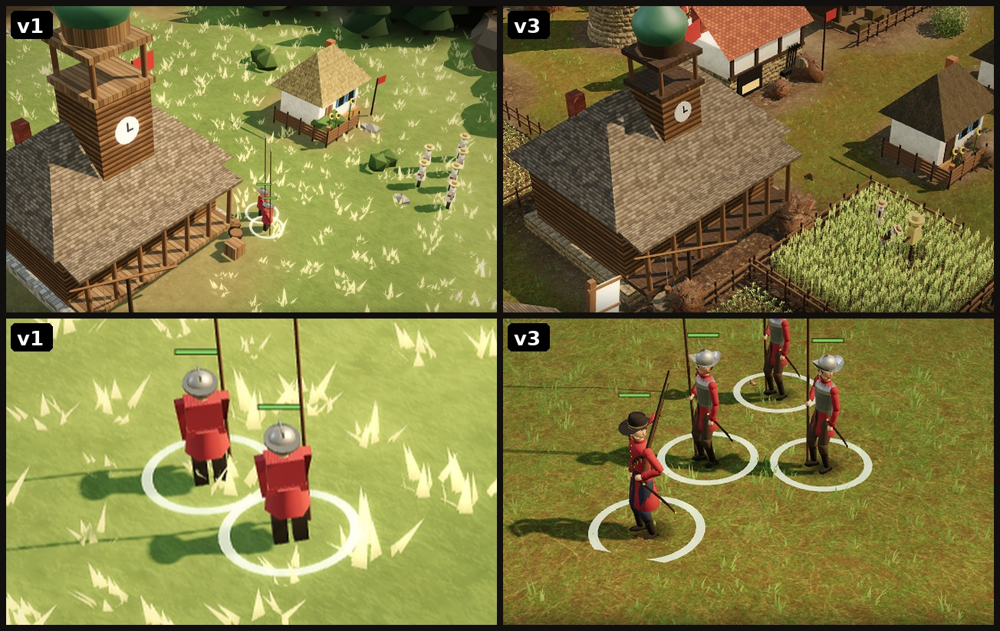

# Wild Fields 1648, a browser RTS written by Claude

**Model:** Claude Opus 5.5 (from the game repo's README and the labels in its own comparison video). Effort was not recorded.  
**Date:** about 10 October 2026. The game files we downloaded are dated 10 October and the public repo was created on 11 October. The days of the build itself were not recorded.  
**Result:** a real-time strategy game on the 1648 Ukrainian steppe that runs in one browser tab. The code lives in its own repo.

- **Play:** https://0xinsiderhq.github.io/wild-fields-1648/
- **Code, tools, tests:** [github.com/0xInsiderhq/wild-fields-1648](https://github.com/0xInsiderhq/wild-fields-1648), release v1.0 with a 12 MB offline file

The code is not copied here. This folder only records the run.

Video: [`media/wildfields_v1_vs_v3.mp4`](media/wildfields_v1_vs_v3.mp4), the first build above v3 for 12 seconds, made with the game's own `tools/video` scripts.



## Prompt

Not saved. We found no prompt for the build in our files or in our Claude Code logs.

## Timeline

Not recorded. The only times we have:

| time (UTC) | what happened | source |
|---|---|---|
| 10 Oct | game files downloaded (`Wild Fields 1648.html`, offline file) | file dates in our Downloads |
| 11 Oct 08:26:46 | public repo created | GitHub API |
| 11 Oct 09:26:19 | last push | GitHub API |

## What it made

According to the game repo's README:

- People on a jointed rig with two-bone IK, foot planting, and walking, running and galloping gaits.
- Wheat that ripens, paths that wear in where peasants walk, trees that fall and leave stumps, burnt buildings that leave ruins.
- AI opponents that build, gather, research and attack.
- Sound synthesised in code.
- v1 used procedural models only. v3 added Poly Haven scans (CC0) that Claude found and downloaded itself by driving a browser, after its sandbox could not reach the asset sites.

## What we measured

| claim | how we checked | verdict |
|---|---|---|
| assets cut down to about 9 MB | `assets/` in the repo is 9.1 MB | true |
| 112 MB of Poly Haven downloads | our download archive `polyhaven_wildfields.zip` is 112,472,692 bytes | true |
| offline version is one 12 MB file | `dist/Wild_Fields_1648_offline.html` is 12,207,036 bytes | true |
| "25 photo-scanned models and PBR textures" | `CREDITS.md` lists 20 models and 12 textures, and `assets/scan_pack.js` holds the same 20 models | **does not match**, see below |
| a 20-minute AI vs AI match runs without errors | `tests/` has the Playwright scripts, but we did not re-run them for this record | not verified |

## What it got wrong

- **The asset count does not add up.** The repo README and the v3 label in the video both say 25 Poly Haven scans. The credits list 20 models and 12 textures, 32 assets in all, and the model pack holds 20 models. We could not find a set of 25.
  Correction: the game's CREDITS list 20 Poly Haven models and 12 textures, not 25. The 25 in the README and the v1/v3 video caption was our mistake.
- **What else went wrong during the build was not recorded,** because we did not keep the chat.

## Reproduce

Without the prompt the build cannot be repeated word for word. The finished game can be run and rebuilt:

```bash
git clone https://github.com/0xInsiderhq/wild-fields-1648
cd wild-fields-1648
python3 -m http.server 8000   # open http://localhost:8000/
python3 build.py              # rebuild index.html and the offline file from src/
```
